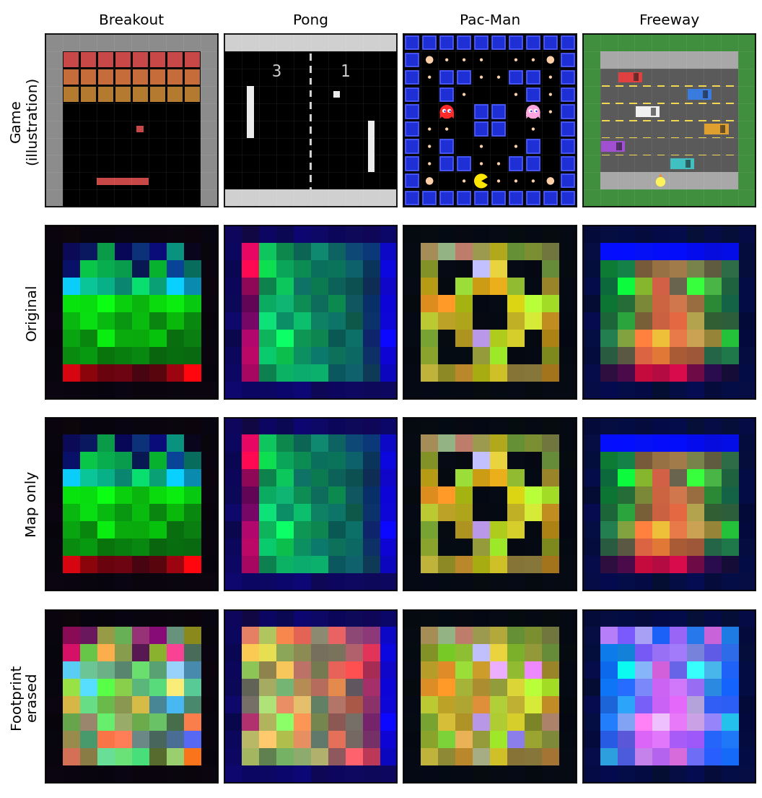

**TL;DR:** We re-ran the two headline experiments from *Sparks of Weight-Space Programming* [1] with the controls they were missing. Both headline numbers have a cheap explanation, and under each one something smaller and real is left over.

- **Reading:** An LLM names the game a small network was trained on just as well after we break the network so it can no longer play, as long as its first layer still shows where the training data was. It reads a map of the training data, not the policy (what the network does).
- **What's left in reading:** With the map erased, the stronger of our two readers still names one game (Pong) from what looks like its policy, and the weaker one can't. The ability is small and the evidence thin, but it may grow with the reader.
- **Editing:** The 7.9% → 48.1% math gain is mostly truncation: the base model runs out of tokens before it answers. Stopping its thinking at a fixed budget and making it answer (budget forcing) matches the edit, with no change to the weights.
- **What's left in editing:** The edit gets the model out of loops, which makes long reasoning usable. What the LLM contributed, and our one automated attempt did not match, is the short contrast texts it wrote to find the edit direction.

The post [1] made two claims, that an LLM can read what a small game-playing network does from its raw weights, and that it can edit a language model's weights to fix a behaviour. Within days, Sean Goedecke [2] pointed out that if you plot the first-layer row norms of a game network on the board, you can see the game, and that the Qwen model, before the edit, had not been bad at math but stuck in loops. Mark VandeWettering [3] made the same point about the loops. These are good observations. We wanted to measure how much each one explains, and found some interesting things along the way.

## Part 1: reading

### The map

The game networks are small MLPs, each a policy: it looks at the board and picks a move. A 10×10 board with 5 binary channels per cell goes in and 5 action scores come out. Row *i* of the first-layer matrix belongs to one (cell, channel) input, and its gradient is proportional to that input. If an input is never 1 during training, its row never moves from initialisation.

In Pac-Man the agent is never inside a wall, so the "agent at wall cell" rows stay at norm ≈ 0.36 while visited cells grow to 3.4–8.1. Draw the row norms on the board and you get the maze:

```python
m = np.linalg.norm(W1, axis=1).reshape(10, 10, 5)   # one number per input, back on the board
thr = 2 * np.median(m[1:9, 1:9, 3])                 # interior obstacle rows are ~untouched init
trained = m > thr                                   # the map
```

<figure>
  
  <figcaption>Top: each game, drawn on the same 10×10 grid (positions of moving objects are illustrative). Second row: row norms of the first layer for the four released networks. Third row: the same for the map-only versions, which can no longer play. Bottom: the footprint-erased versions, which play exactly the same. Red: agent, green: moving objects, blue: reward targets. The other two channels (obstacles, previous frame) are not drawn.</figcaption>
</figure>

The second row shows the first-layer row norms of the four released networks, and each one matches the game above it. Breakout's paddle sits on the bottom row, Pong's on the left column, Pac-Man has its maze, Freeway its goal row. We call this pattern the footprint, the trace of where the training data was. It doesn't describe the policy.

A person can recognise the game from the footprint, but that doesn't mean the LLM uses it. In a normal network the footprint and the policy come together, so a correct answer can't tell us which one the reader used.

### Two controls that separate the footprint from the policy

We built two altered copies of each network. One keeps the footprint but can no longer play (map only). The other plays exactly the same, but its first layer no longer carries the footprint (footprint erased).

**Map only:** The footprint is made of row norms, so we kept every norm and scrambled everything else. Inside each trained first-layer row we shuffled its 32 values, so the row keeps its length but sends each weight to the wrong hidden unit. We also shuffled all later layers. The footprint is identical (third row of the figure). To check that the scrambled network no longer plays the game, we built 4,000 game-like states from the inputs the game actually uses (one agent cell, a few moving objects and targets), gave the same states to it and to the original, and counted how often they picked the same action. They agreed 19% of the time in Breakout, 18% in Pong, 22% in Pac-Man and 12% in Freeway. A player choosing at random among five actions would match 20% of the time, so the policy is gone.

**Footprint erased:** We replaced every untrained first-layer row (an input that was never 1 in training) with a row that looks trained (a random mix of three trained rows plus 5% noise). Those inputs are always 0 in real game states, so the policy should not change. On the same game-like states, it picks the same action as the original 100% of the time in all four games. In the bottom row of the figure, the layout is gone.

A reader that understands the policy should fail on map only and succeed on footprint erased. A reader that only looks at the map should do the opposite. Shuffling all the weights, the control used by Goworek et al. [4], breaks both at once, so it can't tell the two kinds of reader apart.

We used the authors' exact prompt. It describes the grid, the five input channels, the five actions and the network's shape, lists all 17,253 weights, and asks "Which game was it trained on?" It gives no list of games to choose from, so the reader has to come up with the name itself. Each read is a fresh call with no tools. We used two readers, Claude Opus 5.5 and Claude Fable 5.2. We also wrote a reader with no model in it at all, just four rules on the map (agent in one column → Pong, agent in one row under the targets → Breakout, and so on).

| Reader | Original | Map only (can't play) | Footprint erased (plays the same) |
|---|---|---|---|
| Opus 5.5 | 20/20 | 19/20 | 14/40 |
| Fable 5.2 | 12/12 | 20/20 | 26/40 |
| Four rules, no LLM | 4/4 | 4/4 | 0/4 |

Answers vary between calls, so we repeated each read, 5 times per network for Opus and 3 for Fable on the originals, 5 on map only, and 10 on footprint erased. Each cell sums the correct reads over the four games. The rules give the same answer every time, so they run once per network. The numbers differ because we spent reads where the answer was in doubt. The originals were right every time and needed only a few repeats, while footprint erased, the closest result and the one the argument rests on, got the most.

A network that no longer plays the game is named as reliably as the original. A network that plays exactly the same is misread most of the time by Opus once the map is gone. The four rules tie both models wherever the map is present, so the original 4/4 needs no understanding of the policy.

**Key finding:** On these networks the LLMs name the game from the map of where the training data was, not from what the network does. Four hand-written rules on the map do just as well.

### What's left: not there yet, but on the way

The original 4/4 comes from the footprint. The table also shows a second pattern, though, and it's the one we find most interesting.

On the footprint-erased networks, which play exactly like the originals but show no map, Fable is right 26 of 40 times and Opus 14 of 40.

**Key finding:** Without the map, the stronger reader still gets one network right that the weaker one never does.

Our guess is that today's LLMs can't yet read what a network computes from its weights, but the ability may be starting to appear in stronger readers. Two observations point that way, both from comparing Fable, the stronger reader, with Opus.

**Fable reads some behaviour without the map:** On the footprint-erased networks, Fable still names Pong in 9 of 10 reads, and its reasoning is about behaviour, not layout. Its answers describe a unit that tracks the ball's row, anticipates wall bounces, and ignores left/right. Opus gets Pong 0 of 10. Both get Freeway (Fable 10/10, Opus 9/10: lanes in the car weights, a bias toward "up"), Pac-Man about half the time (Fable 7/10, Opus 5/10), and neither ever names Breakout. They call it a catching or dodging game. This fits Goworek et al. [4], who found that on new games readers recover the layout but mostly miss the mechanics.

**Fable found the leak in our control:** Our first footprint-erased version filled the dead rows with *copies* of trained rows. Opus dropped to 10/20, which looked like a clean result. Then Fable scored 15/16 on it. Its answers said things like "only 8 distinct vectors". It had spotted the duplicate rows and used the pattern of duplicates to recover the map. That is not reading the policy, but it is the kind of structural analysis of raw weights that reading the policy needs, and Opus didn't do it.

The ability is still narrow and expensive. Fable writes about 113k tokens per read without the map, against about 12k with it, and so far it only works for policies that are simple to state. It is also one comparison between two models, and most of the gap is one network: 9 of Fable's 12 extra correct reads are Pong. The claim that Fable read behaviour rests on its own account of its reasoning, and the fill is not perfectly hidden (see the next section), so some of what it used may still be layout. Still, it points one way. A stronger reader gets more out of the weights, both the function and the shortcuts.

### Attacking our own control

To fix the leak, we filled each dead row with a random mix of three trained rows plus 5% noise, so no two rows are identical. This is the footprint-erased version in the table above. We also tried Gaussian noise fitted to the trained rows, and dropped it because it was easier to spot. Trained rows are not Gaussian. Their weights are mostly small with a few large ones, and in some channels they share a few common directions. Gaussian rows have neither, while a mix of trained rows inherits both.

Then we tried to break it ourselves, looking for any way to tell filled rows from trained ones. Simple statistics fail, since row norm, largest weight and kurtosis look the same for both. One test does work. A filled row is a mix of three other rows, so it can be rebuilt from them almost exactly, and a trained row can't. Ranking rows by how well they can be rebuilt finds the filled ones with AUC 0.83–0.89. But that is not enough to recover the map. When we run the four rules on what it finds, they answer "Pac-Man" for every game.

So the fill is good enough, but not perfectly clean. Anyone building a control like this should attack it with every tool a strong reader has, because the next reader will try them all.

## Part 2: editing

The second claim in [1] is about writing weights. At the post's settings, Qwen3.5-0.8B scores 7.9% on MATH-500. An LLM (GPT-6 Astra) inspected the model and wrote an edit to its weights, and the edited model scores 48.1%. In our re-run, with 4 samples per problem, the two numbers are 8.6% and 51.0%, and those are the ones we use below. Goedecke [2] and VandeWettering [3] argued that the base model was not bad at math but got stuck in loops and never finished its answer. We measured how much of the gain that explains, and what the edit adds beyond it.

### What the edit does

The edit is a directional ablation. It subtracts a "loop direction" *u* from 64 MLP output columns in layers 15 and 19, with strength 6. We recovered it by comparing the edited weights with the original. Nothing else changed. For each edited column *W<sub>j</sub>* of the MLP output matrix:

```python
W[:, j] -= alpha * u * (u @ W[:, j])   # u: unit vector, alpha = 6
```

`u @ W[:, j]` is how much column *j* writes along *u*. With strength 1 this would remove that part exactly. With 6, it flips its sign and makes it five times larger, so the edit pushes the model away from the loop direction rather than just removing it. It is the same kind of edit as removing the refusal direction [8], as Goedecke [2] noted.

### The missing baseline

On MATH-500 at the post's settings, the base model hits the 32k-token limit on 92% of answers. A cut answer almost never reaches a final `\boxed{}`, so nearly all of them are graded wrong (16 of 1,844 had a boxed answer in their thinking and counted). The 8.6% baseline measures truncation, not math.

These runs already use a repetition penalty: presence penalty 1.5, Qwen's recommended setting and the one the original post used. The model loops anyway.

**Key finding:** There is a much simpler fix than editing weights: stop the thinking before it hits the limit, and make the model write its answer.

This is budget forcing, from s1 [9]. At a fixed thinking budget we cut the thinking and append this string, which closes the thinking and starts the answer:

```python
FORCE = "\n</think>\n\nFinal Answer: \\boxed{"
```

| MATH-500, 500 problems × 4 samples | Accuracy |
|---|---|
| Base, as in the post | 8.6% |
| LLM's edit, as in the post | 51.0% |
| Base, thinking off | 43.7% |
| Base, budget forcing at 16k | 50.3% |

Budget forcing on the untouched model scores 50.3%, against 51.0% for the edit. It recovers 98% of the gain with no change to the weights, and the +0.7 point difference has a confidence interval that spans zero.

The exact string matters. If we only close the thinking with a bare `</think>` at the same 16k budget, accuracy is 34%. Instead of answering, the model starts solving the problem again, runs out of its 2,048 answer tokens, and 65% of answers are cut before reaching `\boxed{}`. Adding `Final Answer: \boxed{` forces it to answer immediately.

### What the edit adds

If truncation were the whole story, the edit would be worthless. It isn't. Apply budget forcing to both models and vary the thinking budget:

| Thinking budget | Base + budget forcing | Edit + budget forcing | Edit − base, before rounding (95% CI) |
|---|---|---|---|
| 4k | 47.5% | 47.9% | +0.4 (−1.6 to 2.2) |
| 8k | 50.2% | 53.6% | +3.4 (1.5 to 5.3) |
| 16k | 50.3% | 57.4% | +7.0 (5.0 to 9.1) |
| 32k | 49.6% | 58.4% | +8.7 (6.5 to 11.0) |

Base stops improving at 8k, while the edit keeps turning extra thinking into accuracy. The saved answers show why. Both models start repeating early, but 90% of base's answers end inside a loop, against 11% for the edit. When the edited model starts looping, it gets out in about seven answers of eight.

**Key finding:** The edit doesn't help short reasoning. It gets the model out of loops at the right time, which makes long reasoning usable.

The same pattern holds outside math. We ran MMLU-Pro (1,000 questions × 2 samples).

| MMLU-Pro | Base | Edit | Edit − base, before rounding (95% CI) |
|---|---|---|---|
| Thinking off | 35.7% | 34.4% | −1.3 (−3.5 to 0.9) |
| Thinking, 32k, as in the post | 6.5% | 38.0% | +31.5 (28.9 to 34.0) |
| 8k + budget forcing | 37.5% | 39.3% | +1.8 (−0.4 to 3.9) |
| 32k + budget forcing | 37.0% | 41.3% | +4.2 (2.1 to 6.5) |

With thinking off, the edit costs no knowledge. At the post's settings it looks like a huge gain, but that is truncation again, since 90% of base's answers are cut off before they reach an answer. With budget forcing, the edit's lead is small at 8k and grows at 32k, as on MATH. Budget forcing closes most of the gap, but not all of it.

### Which part of the edit needed the LLM?

The edit needs three choices: the direction *u*, which columns to edit, and how much to change each one. According to the authors' logs, the LLM made all three. Barry [7] showed that a linear program can choose the columns and sizes, and that with the LLM's direction it matches the LLM's edit, even on different columns. That leaves the direction.

We built our own edit with no LLM. It has the same form as the LLM's (the code above), only every choice is made automatically. For the direction, we marked a token as part of a loop if the 32 tokens ending at it had already appeared, word for word, earlier in the same answer, and took the difference of mean MLP outputs between loop and clean tokens. We then took the columns that write most along that direction, and tuned the layers, the strength and the number of columns with the same 50 tries the LLM had. The search ended up on layers 15 and 19, the same ones the LLM chose.

| Edit (MATH-500) | Post's settings: 32k limit, cut answers graded wrong | Same, with budget forcing | Base thinks until a loop, then this model continues |
|---|---|---|---|
| None (base) | 8.6% | 49.6% | 51.8% |
| LLM's direction and columns | 51.0% | 58.4% | 59.6% |
| Our automated direction and columns | 44.2% | 47.0% | 53.1% |
| LLM's direction, linear program (reported by [7]) | 51.7% | – | – |
| Barry's automated direction, linear program (reported by [7]) | 47.8% | – | – |

In the last column, base thinks until a loop starts, the answer is cut there, and that row's edited model continues from the cut. In the base row, base itself continues, and even that gains a little (51.8% vs 49.6%), so 51.8% is the number to beat.

With budget forcing, our automated edit scores below the unedited model (47.0% vs 49.6%). Barry's automated direction reaches 47.8% without budget forcing, but we don't know yet whether budget forcing would lift it above 49.6%. Only the LLM's direction turns extra thinking into clearly more accuracy, both with budget forcing and when switched in at the loop.

Where did the LLM's direction come from? According to the logs, the LLM wrote [four pairs of short texts](https://github.com/RikiyaT/lm_understand-logs/blob/main/exp8_math/runs/p50c/requests/fwd_4.json.claimed), one pair per math problem. Both texts in a pair start with the same correct steps. Then one keeps solving and checks its answer, and the other repeats one sentence:

> **Productive:** … Adding the remaining 20 gives 38 hours. His pay is 38\*20=760 dollars. Checking: 200+160+400=760, consistent with the total.
>
> **Looping:** … Adding the remaining 20 gives 38 hours. But is 20 the total? No, it is the remaining time. But is 20 the total? No, it is the remaining time. But is 20 the total? No, it is the remaining time.

The LLM ran all eight texts through the model and took the difference of mean hidden states over each text's last 36 tokens, looping minus productive. Within a pair the problem and the opening are the same, so the only difference is repeating versus moving on. Our automated direction instead compares loop tokens with earlier clean tokens in real answers, and those also differ in position and content. Ours also uses MLP outputs rather than hidden states. Either difference could be why it does worse.

**Key finding:** What the LLM measurably contributed was not the weight arithmetic but the contrast texts it wrote to isolate the failure. That is real, but much narrower than "it edited the weights".

## Wrap-up

Both headline numbers have a cheap explanation. Underneath each one is a smaller effect that is real.

**On reading, what today's models mostly see in a network's weights is its training data, meaning which inputs ever occurred and where.** That is a statistic of the dataset, not a description of the computation, and a simple rule reads it just as well. But it isn't all they see. With the map gone, Fable still named Pong and described its network as tracking the ball's row, and Opus could not. That ability is small, it costs about nine times the tokens, it covers only policies a sentence can describe, and so far we have seen it on one network with two readers. **If it grows with the reader, that is the trend to follow.**

**On writing, the LLM did not do anything a person couldn't follow. It used a known interpretability method, removing one direction from a few columns, and fixed a failure that shows up in decoding.** The part our one automated attempt did not match was not the weight arithmetic. It was picking which texts to contrast to get the direction. That looks less like an LLM programming weights and more like an LLM doing the work of an interpretability researcher, who forms a hypothesis about a failure, builds the data to isolate it and applies a standard tool. We think that is the more promising version of the idea, and it is much easier to check.

A few caveats. We tested four networks and one edited model, all from the original post. We kept the original decoding settings and did not try stronger or different repetition penalties. Our automated direction is one attempt, and it differs from the LLM's in two ways at once (the texts it contrasts, and MLP outputs instead of hidden states), so we can't tell which one costs it. Both our readers are Claude models, and we had no access to GPT-6 Astra, which the original experiments used. Other responses go in different directions. Shechter [5] reverse engineered the from-scratch Breakout network into a short program of threshold gates, and Wang et al. [6] analysed the edit as steering.

Thanks to the original authors. Their post asked a bold question and started a lively debate, and they released every prompt, network and log, so anyone could check the claims. None of this work would have been possible without that.

Code, prompts and every model answer are on [GitHub](https://github.com/OfirShechter/weight-space-programming-controls), and the tables in this post can be rebuilt from them on a CPU. A detailed paper is coming to arXiv soon.

## References

1. R. Takehi, J. Teoh, A. Zhang, O. Khattab. [Sparks of Weight-Space Programming](https://rikiyat.github.io/blog/weight-space-programming/). Blog post, 2 Nov 2026. Released files: [github.com/RikiyaT/lm_understand-logs](https://github.com/RikiyaT/lm_understand-logs).
2. S. Goedecke. [LLMs are not superhuman at reading and writing neural network weights](https://www.seangoedecke.com/llms-are-not-superhuman-at-reading-and-writing-neural-network-weights/). Blog post, Nov 2026.
3. M. VandeWettering. [A Skeptical Look at Weight-Space Programming](https://brainwagon.org/blog/2026-11-08-a-skeptical-look-at-weight-space-programming.html). Blog post, 8 Nov 2026.
4. R. Goworek, A. Hickey, F. Nanni, M. O'Reilly. [Replicating and Extending Weight-Space Programming](https://arxiv.org/abs/2611.21449). arXiv:2611.21449, 2026.
5. S. Shechter. [Sparks of Weight-Space Programming, or Just Exploit Engineering?](https://www.cyera.com/research/sparks-of-weight-space-programming-or-just-exploit-engineering) Cyera Research, 16 Nov 2026.
6. Z. Wang, B. Hsu, T. Wang, M. Belkin. [A Closer Look at Sparks of Weight-Space Programming](https://lesswrong.com/posts/PD8Hmzro4N3piJSMP/a-closer-look-at-sparks-of-weight-space-programming). LessWrong, 17 Nov 2026.
7. N. Barry. [Can a Linear Program Do Weight-Space Programming?](https://nathan.rs/posts/weight-space-lp/) Blog post, 9 Nov 2026.
8. A. Arditi et al. [Refusal in Language Models Is Mediated by a Single Direction](https://arxiv.org/abs/2406.11717). NeurIPS 2024.
9. N. Muennighoff et al. [s1: Simple test-time scaling](https://arxiv.org/abs/2501.19393). arXiv:2501.19393, 2025.
